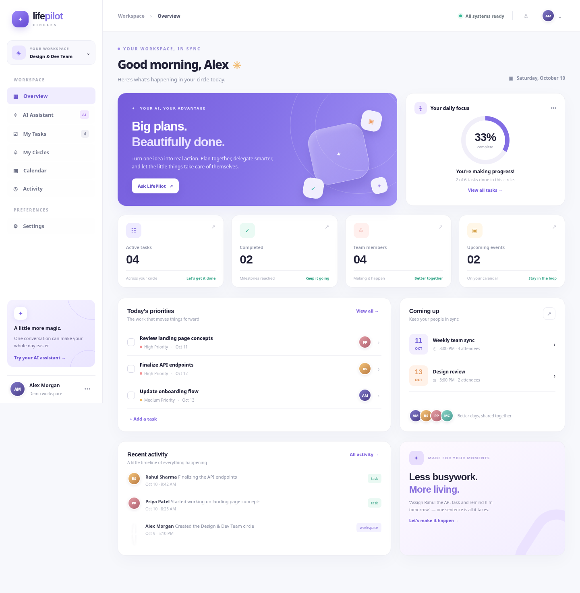

# ✦ LifePilot Circles

**Make more happen, together.** A beautifully designed AI action assistant for families and small teams. Translate natural-language requests into a reviewable plan, then use actual MCP tools to assign tasks, schedule circle events, create reminders and send notifications—**only after approval**.



**Status:** Local hackathon MVP implementation (not production-ready). The Next.js UI is functional and connected to FastAPI; the screenshot is an illustrative static visual snapshot. External providers require their own credentials and configuration.

## Stack

- **Frontend**: Next.js 16 App Router, React 19, TypeScript, Lucide icons, original responsive CSS (no paid assets)
- **Backend**: Python 3.13 recommended (3.14 where dependencies support it), FastAPI, Pydantic, SQLite for reproducible local demo
- **AI**: LangChain + NVIDIA Nemotron (`NVIDIA_API_KEY`), deterministic demo planner without credentials
- **Workflows**: LangGraph human-in-the-loop `interrupt()` and `Command(resume=...)`
- **Tools**: official Python MCP SDK **2.x**, stdio client calls plus optional localhost Streamable HTTP MCP server
- **Integrations**: in-app reminders, calendar events + ICS exports, in-app messages; optional SMTP / Slack webhook

## Vercel Services (three-service preview architecture)

The review branch configures Next.js `web` (public), FastAPI `api` (internal)
and MCP Streamable HTTP `mcp` (internal) as **one Vercel project**.

- `web → api`: runtime `API_SERVICE_URL`
- `api → mcp`: runtime `MCP_SERVICE_URL`
- `mcp → api`: runtime `API_INTERNAL_URL` to execute only approved actions
- Persistent PostgreSQL is required for Vercel (`DATABASE_URL`).
- Reminders use a protected scheduler endpoint; no billed recurring cron is
  created automatically.

See [Vercel deployment architecture and outstanding validation](docs/VERCEL_SERVICES.md).
The review branch is **not deployed, not merged and not production-ready**:
real authentication and end-to-end Vercel/MCP integration still need checking.

## Getting started (Windows PowerShell)

From the repository root (`C:\AZ\lifepilot-ai` on your machine):

```powershell
python -m venv .venv
.\.venv\Scripts\Activate.ps1
python -m pip install -r .\services\api\requirements.txt
Copy-Item .env.example .env
```

Edit `.env`, set a random `API_SECRET` and optionally your `NVIDIA_API_KEY`.

**Terminal 1 — API**

```powershell
python .\services\api\run.py
```

Check `http://127.0.0.1:8000/healthz` and API docs at `http://127.0.0.1:8000/docs`.

**Terminal 2 — Next.js**

```powershell
cd .\apps\web
Copy-Item .env.example .env.local
npm install
npm run dev
```

Open **http://127.0.0.1:3000**. Default demo account: Alex. Click the avatar top-right to switch demo personas; this does NOT constitute production authentication.

### Option B: Docker Compose

```powershell
Copy-Item .env.example .env
# Edit .env: change API_SECRET

docker compose up --build
```

Open http://127.0.0.1:3000, API at http://127.0.0.1:8000, and localhost MCP at http://127.0.0.1:8010/mcp.

### How to demonstrate actual AI + MCP actions

1. Open the **AI Assistant** tab.
2. Enter: `Assign Rahul the backend API task by Friday and remind him tomorrow`.
3. See the proposed actions and **nothing executed yet** message.
4. First try **Reject**; check Tasks—you should see no new task.
5. Repeat and click **Approve**. API launches the actual MCP server over stdio and calls the tool(s).
6. Check **My Tasks** and **Activity**; switch to Rahul to see the in-app assignment notification.
7. Create an event on the Calendar page and download its `.ics` file.

With a valid NVIDIA key, action suggestions are generated by the model and validated server-side. Without a key, the UI **explicitly labels** the planner `DEMO PLANNER` and produces deterministic suggestions; it is not falsely advertised as AI output.

## Verify MCP directly

The Python SDK v2 server is at `services/mcp-server/server.py`.

```powershell
python .\services\mcp-server\server.py --http
```

On `http://127.0.0.1:8010/mcp` you can use an MCP Inspector/client; tool calls require valid signed demo tokens in tool arguments. HTTP binds only to loopback by default—**do not expose it publicly without standards-compliant OAuth**. For stdio Inspector testing, run:

```powershell
npx -y @modelcontextprotocol/inspector python .\services\mcp-server\server.py
```

## Tests

```powershell
python -m pip install pytest httpx
$env:PYTHONPATH="services/api"
python -m pytest -q tests
```

Tests use local tool adapter to avoid subprocess/network dependencies. Real MCP 2.x integration still needs to be tested in your installed development environment.

## Directory map

```text
apps/web/                  Next.js responsive app
services/api/app/          FastAPI + LangChain + LangGraph + domain logic
services/mcp-server/       MCP 2.x tool server (stdio and Streamable HTTP)
packages/contracts/        API contract notes
infra/                     Development Dockerfiles
docs/                      Architecture, learning guide, limitations
preview/                   Browser-independent dashboard design preview
tests/                     Automated workflow and permission tests
```

## Documentation

- [Architecture and safety limitations](docs/ARCHITECTURE.md)
- [Learning walkthrough](docs/LEARNING_GUIDE.md)
- [Frontend and backend API contract](packages/contracts/API.md)

## Important limitations

This is an **implementable working MVP**, not a completed production product. `DEMO_MODE=true` grants persona switching; **never deploy public with it enabled or use real personal data in it**. The persistent database is currently SQLite, not PostgreSQL. Google Calendar OAuth is **not** integrated; calendar export works through ICS. Email/Slack deliver externally **only** when SMTP/Slack credentials are configured. Background reminders deliver in-app; external scheduled notification delivery and user consent preferences remain future work. InMemorySaver is not a durable multi-worker checkpoint store; SQLite proposal records are the fallback for pending approval after a process restart.

**Hackathon:** Amazon Developer Hackathon 2026, proposed Alexa+ MCP route. Submission requirements must be checked against the organizer's latest published rules, and protocol compatibility should be demonstrated in Inspector. This source is not itself an Alexa+ Agent Skill.

## License

MIT. Copyright (c) 2026 LifePilot Circles contributors.
